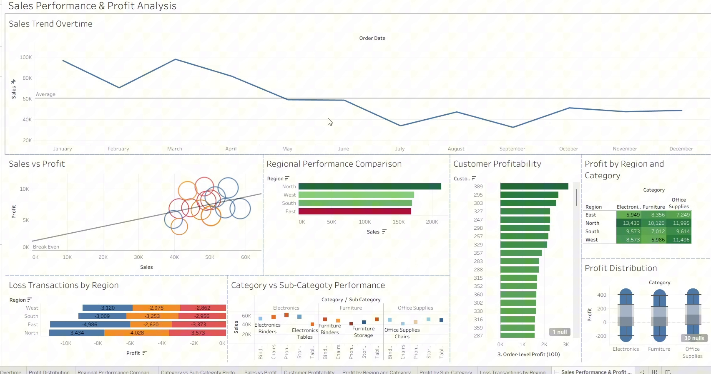

# Sales Performance & Profit Analysis (Tableau)

An interactive Tableau dashboard analyzing 1,200 retail transactions across four Canadian regions. The project covers combining two tables with different levels of detail, handling missing values, LOD expressions, and finding where profit is made and lost.

**Tools:** Tableau Desktop · calculated fields · LOD expressions · data modelling

## Business questions

- Which regions, categories and customers drive sales and profit?
- Where is the business losing money?
- How do sales change over time?

## Data

[`data/sales_dataset.xlsx`](data) contains two related sheets of synthetic retail data from a course exercise:

| Sheet | Rows | Grain | Fields |
|---|---|---|---|
| **Orders** | 500 | One row per order | Order ID, order date, customer ID, region, city |
| **Details** | 1,200 | One row per line item | Order ID, product ID, category, sub-category, sales, quantity, profit |

Orders run from **January 2022 to May 2023**. The data includes deliberate quality issues: 19 missing cities, 30 missing profit values, dates stored as Excel serial numbers, and 46 orders with no line items.

## Data modelling

**Relationship, not a join.** Orders and Details have a one-to-many relationship on `Order ID`. A join would copy each order's fields onto every line item (*fan-out*), which inflates anything counted or summed at the order level. A Tableau **relationship** keeps each table at its own level of detail and aggregates correctly for each view.

**Calculated fields**

| Field | Formula | Purpose |
|---|---|---|
| Profit Ratio | `ZN(SUM([Profit])) / SUM([Sales])` | Profit as a share of revenue |
| Sales per Quantity | `SUM([Sales]) / SUM([Quantity])` | Average revenue per unit |
| Order-Level Profit | `{FIXED [Order ID]: SUM([Profit])}` | LOD expression for customer-level profitability |

**Cleaning**

- Converted Excel serial numbers to real dates.
- Replaced missing cities with `"Unknown"` so no transactions are dropped.
- Used `ZN()` to treat missing profit as 0 in calculations while leaving the source data unchanged.
- Changed `Order ID` from a measure to a dimension, since it's an identifier.

## Key findings

| KPI | Value |
|---|---|
| Total sales | $726K |
| Total profit | $109K |
| Profit ratio | 15.1% |

1. **North leads on both sales and margin.** It has $214K in sales and a 16.6% profit ratio. East has the lowest margin (12.8%) on similar sales to South and West (about $170K each).
2. **Office Supplies is the most profitable category.** It earns $40.4K in profit at a 17.3% margin. Electronics brings in the most revenue ($259K), but its margin is lower (14.5%), close to Furniture's.
3. **Losses happen everywhere.** Every region and category has loss-making transactions. The largest pocket is **East Electronics (−$5.0K)**, followed by North Furniture (−$4.0K) and North Office Supplies (−$3.6K).
4. **Profit is concentrated in a minority of customers.** The top 20% of customers generate **53% of profit**, and 26 of 179 customers are net loss-makers. The order-level LOD expression keeps these figures accurate.
5. **No strong seasonality in 2022.** Monthly sales in 2022 ranged from about $32K to $59K with no clear Q1 peak.

> **Known issue:** the *Sales Trend Overtime* chart uses `MONTH(Order Date)`, which **adds January–May 2023 on top of January–May 2022**. That makes early months look much higher than the rest of the year (for example, January shows about $97K, but January 2022 alone was $52K). Switching the axis to a continuous month (`MONTH-YEAR`) gives the true trend.

## How to open

Download `sales_profit_analysis.twbx` and open it in [Tableau Desktop](https://www.tableau.com/products/desktop) or the free [Tableau Public](https://public.tableau.com/app/discover). The `.twbx` file has the data embedded.

## Context

Individual assignment for Advanced Data Visualization, Master of Data Analytics, University of Niagara Falls Canada (2026).
